# Site-Trabalho-Prático-1

Projetos de Desenvolvimento de Interface Web

Trabalho Prático 1 - Produção de Site
## Aluno

-**Nome:** Tiago Henrique Gomes Formiga
-**Matricula:** 926142

## Sobre o projeto

A minha ideia foi fazer um site para o clube que minha familia frequenta na cidade que ela veio, Sabará. Como o clube já tinha um site, decidi usar ele como base, tentar fazer algo parecido mas, com diferenças que eu acho que deixariam mais interessantes, como a aba proximo evento, e o botão para voltar ao inicio.
Ficou bem parecido e do jeito que eu gostaria.
As novas adições desse momento do projeto retiraram os antigos cards e mudaram para novos, adicionaram o sobre do aluno e uma nova pagina com o detalhe de cada evento, além de JavaScript e dados de estrutura JSON

- **Entidade principal:** eventos do clube.
- **Entidade secundária:** fotos de cada evento.

## Wireframe

Wireframe feito no MockFlow:
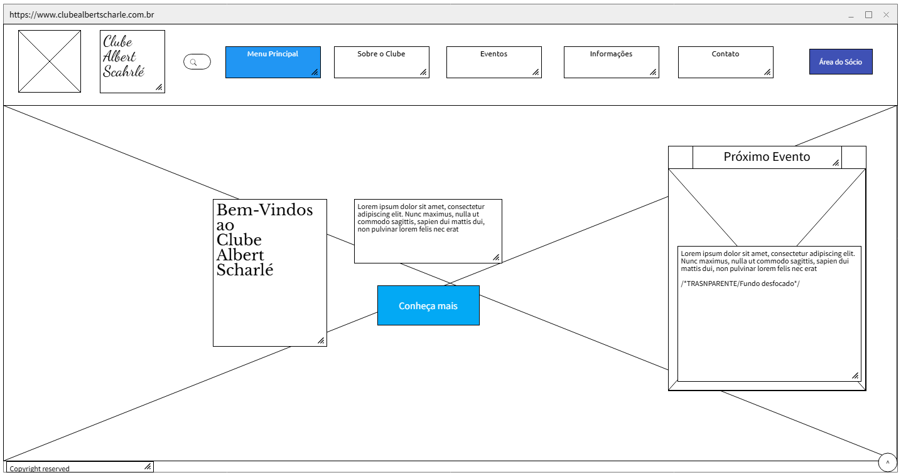

## Home

Tela da Home do site (antiga):

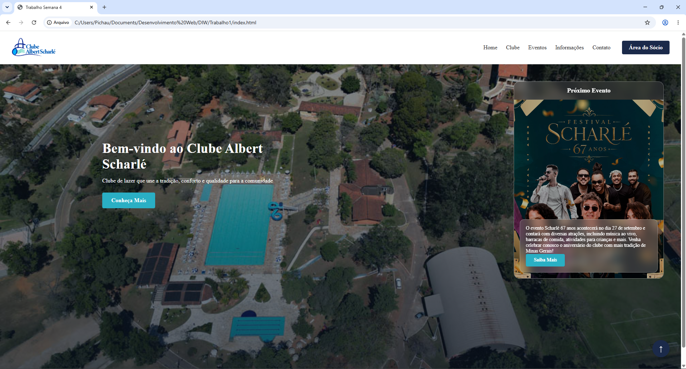

Tela da Home do site (atualizada):

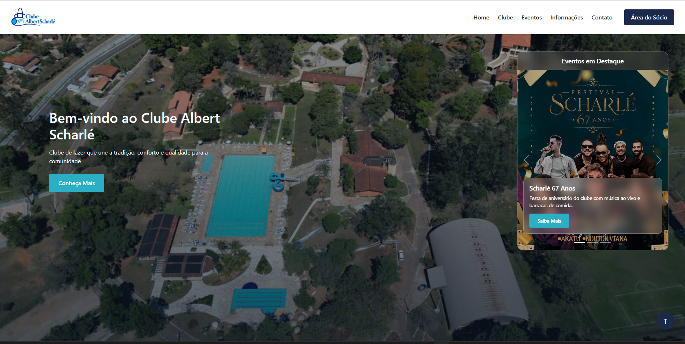
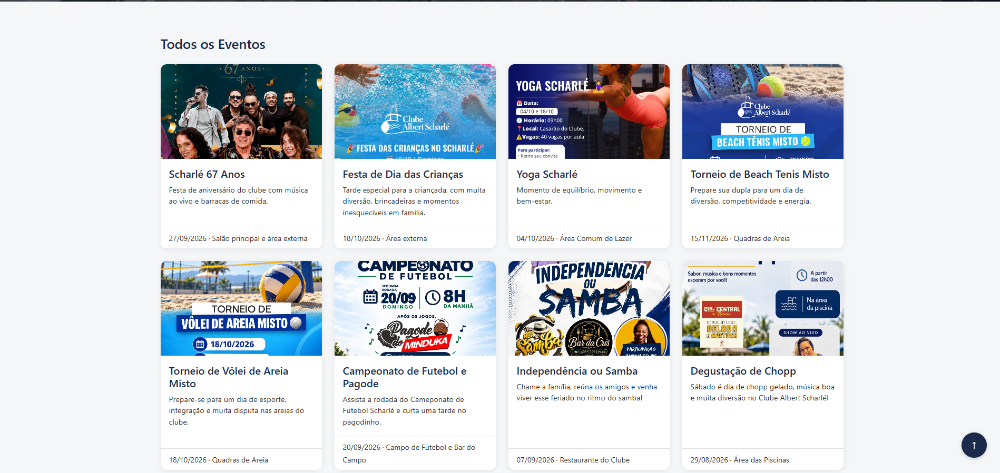
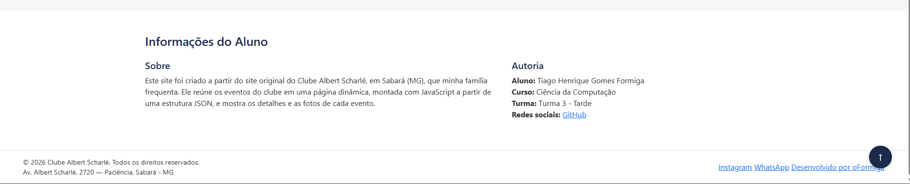

## Home no mobile

Tela da Home do site no mobile (antiga):

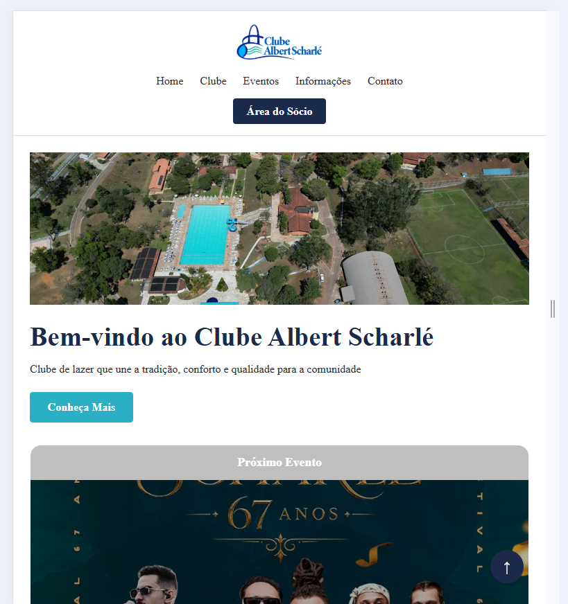
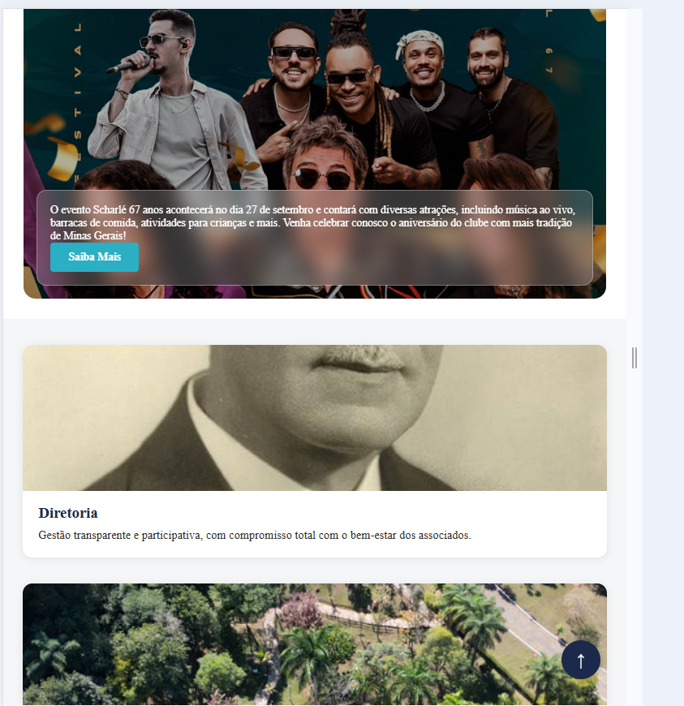
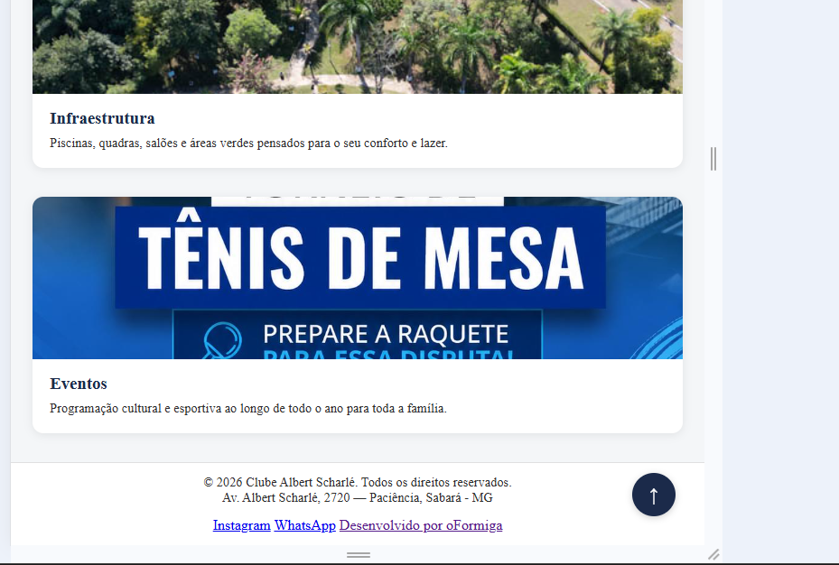

Tela da Home do site no mobile (atualizada):

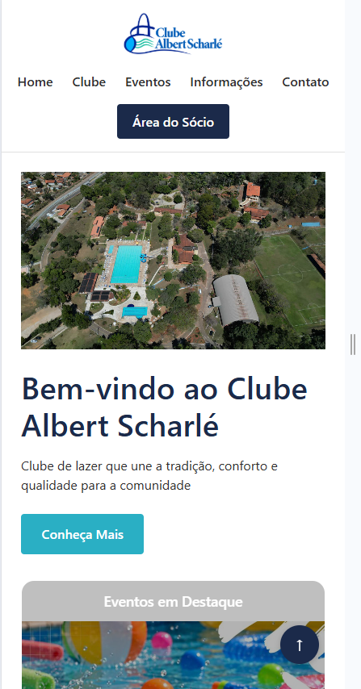

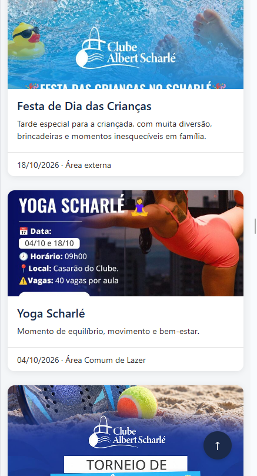

## Página de detalhes

Tela dos Detalhes:

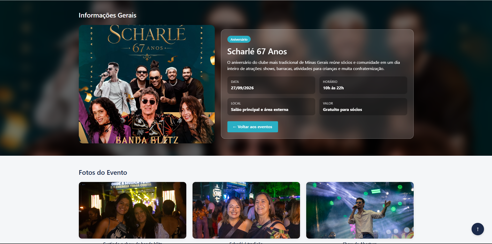
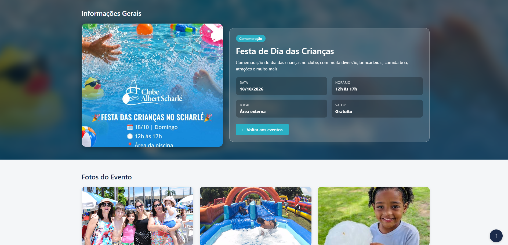

## Página de detalhes no mobile

Tela dos Detalhes no mobile:

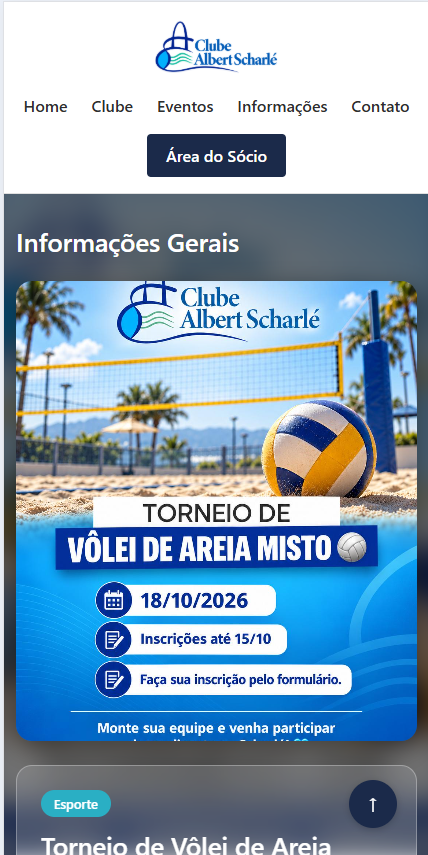
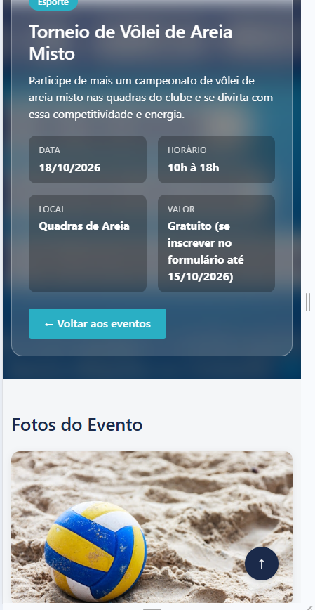
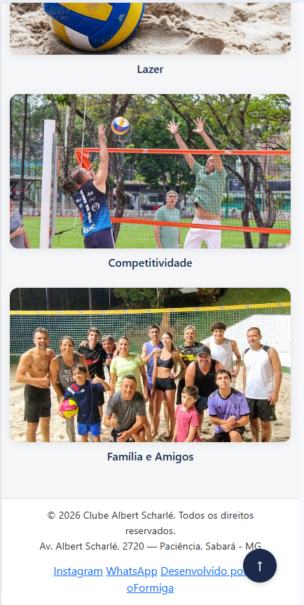

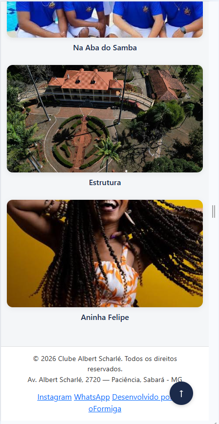
